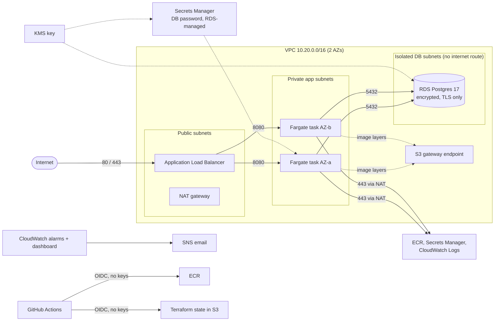

# terraform-ecs-platform

A production-shaped AWS platform for a containerized web service, built
entirely with Terraform: a multi-tier VPC, an Application Load Balancer, ECS
Fargate, RDS Postgres, encryption with a customer-managed KMS key,
CloudWatch alarms and dashboards, and a GitHub Actions pipeline that deploys
through OIDC with no stored AWS keys.

The app is a small URL-shortener API. The infrastructure is the point.

## Architecture



Every hop is allowed by a security-group rule that names the sender's security
group, not an IP range: internet → ALB on 80/443, ALB → tasks on 8080,
tasks → Postgres on 5432. Nothing else gets in.

## What's in it

| Area | What it does |
| --- | --- |
| Network | VPC across 2 AZs with three tiers: public (ALB and NAT), private app, isolated DB with no internet route. One NAT by default, one per AZ with a single flag. VPC flow logs, locked-down default security group, free S3 gateway endpoint. |
| Compute | ECS Fargate service in private subnets with no public IPs. Rolling deploys keep full capacity and roll back automatically if new tasks fail health checks. Autoscales on CPU and requests per task. Read-only root filesystem, non-root user. |
| Data | RDS Postgres 17 in isolated subnets. Encrypted with KMS, TLS forced, automated backups. The password is generated and rotated weekly by RDS in Secrets Manager; the app reads it per connection, so rotation never breaks it. It never appears in code, Terraform state or the task definition. |
| Security | Least-privilege IAM: the execution role can only pull its own image and write its own logs; the app role can only read its own database secret. Every role the pipeline creates carries a permissions boundary, so even the deploy pipeline can't mint an admin role. Customer-managed KMS key with rotation. ECR images are immutable and scanned on push; deploys stop on critical findings. |
| Observability | JSON request logs, CloudWatch dashboard (traffic, errors, latency, task health, DB), alarms for app 5xx, unhealthy tasks, p95 latency, CPU and DB storage, routed to email. Each alarm links to its runbook section. Monthly budget alert. |
| Delivery | CI on every PR with no AWS account needed: app tests including a password-rotation test against a real Postgres, container build and smoke test with a read-only filesystem, `terraform fmt`/`validate`, 15 offline module tests against a mocked AWS provider, Checkov scans. Deploys and teardown are manual, approval-gated workflows using GitHub OIDC. Actions are pinned to commit SHAs; Dependabot keeps them current. |

## Cost

Building, testing and scanning are free: CI runs on GitHub's free runners for
public repos and needs no AWS account. Only a live deploy costs money.

| While deployed (us-east-1) | Approx. per day |
| --- | --- |
| NAT gateway + its IP | $1.20 |
| Load balancer + public IPs | $0.80 |
| 2 Fargate tasks (0.25 vCPU, 0.5 GB) | $0.60 |
| RDS db.t4g.micro + 20 GB | $0.45 |
| KMS, Secrets Manager, CloudWatch | $0.10 |
| **Total** | **about $3/day** |

Deploy, test for a few hours, destroy: well under $1. After teardown the only
thing left is the Terraform state bucket (cents per month). Prices are
on-demand list prices and approximate; check the AWS pricing pages before
relying on them.

## Run it

**One-time setup**
1. `cd infra/bootstrap && terraform init && terraform apply` with your own admin credentials. It creates the state bucket, the permissions boundary and two GitHub OIDC roles. If your account already has a GitHub OIDC provider, add `-var create_github_oidc_provider=false`.
2. In the GitHub repo settings:
   - Secrets: `AWS_PLAN_ROLE_ARN`, `AWS_DEPLOY_ROLE_ARN` (from the bootstrap outputs)
   - Variables: `TF_STATE_BUCKET`, `ALERT_EMAIL`
   - Environments: create `dev`, add yourself as a required reviewer, and limit deployment branches to `main` (the deploy role trusts any job in that environment)
3. About a day after the first deploy, activate `Project` as a cost allocation tag in the Billing console. The budget filters on it and reads $0 until then.

**Deploy:** Actions → *Deploy (dev)* → Run → approve. Or locally: copy
`backend.hcl.example` to `backend.hcl` and run `./scripts/deploy.sh`.

**Try it**
```bash
URL=$(terraform -chdir=infra/envs/dev output -raw app_url)
curl -X POST $URL/links -H 'content-type: application/json' -d '{"url":"https://example.com"}'
curl -i $URL/<code>
```

**Destroy:** Actions → *Destroy (dev)*, or `./scripts/teardown.sh`, which also
checks nothing billable is left.

## Exercises

- `./scripts/load-test.sh` — push traffic and watch autoscaling add tasks.
- `./scripts/incident-drill.sh break` then `fix` — delete a security-group rule
  the way someone might in the console, watch the alarms fire, and let Terraform
  detect and repair the drift. Write it up with
  [docs/postmortem-template.md](docs/postmortem-template.md).

## Known limits

This is a demo meant to run for hours, not an open public service. Anyone who
can reach the load balancer can create links, so a long-lived deployment would
be an open redirector. Production would add authentication or AWS WAF rate
limiting, and a least-privilege database user instead of the RDS master user.
See [docs/decisions.md](docs/decisions.md).

## Docs

- [docs/decisions.md](docs/decisions.md) — why ECS over EKS, one NAT, the security-group layout, and what changes for production
- [docs/runbook.md](docs/runbook.md) — what to do when each alarm fires
- [docs/postmortem-template.md](docs/postmortem-template.md)

## Layout

```
app/                  FastAPI service, tests, Dockerfile
infra/bootstrap/      state bucket + GitHub OIDC roles (run once)
infra/modules/        network, ecr, alb, ecs_service, database, observability (+ tests)
infra/envs/dev/       wires the modules together; security-group rules between tiers
scripts/              deploy, teardown, load test, incident drill
.github/workflows/    ci, deploy, destroy
```
